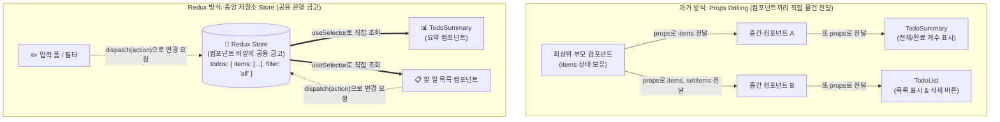
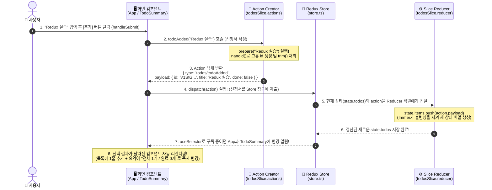
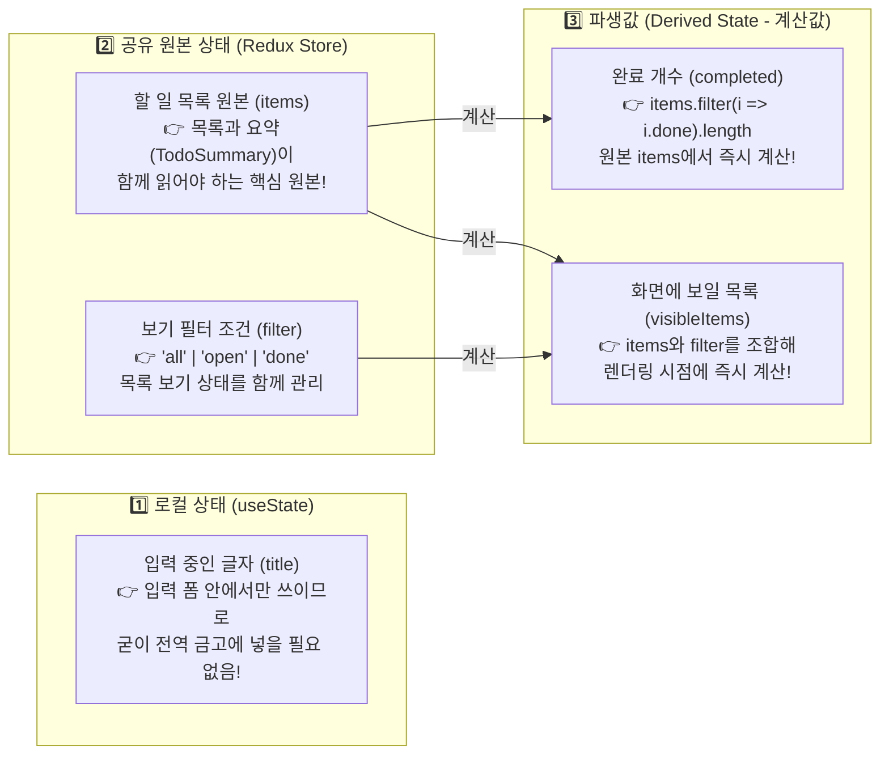
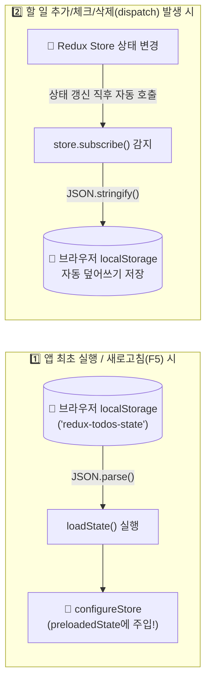

# [실습 & 아키텍처 가이드] 3. React Redux Toolkit 상태 관리 & 할 일(Todo) 앱 누적 실습 가이드

이 문서는 강의 교안(**`05_09_react_Redux_Toolkit.pdf`**)의 **Redux Toolkit 기반 할 일(Todo) 관리 애플리케이션 실습**을 처음 접하는 학습자가 **`store`, `slice`, `dispatch`, `reducer`, `selector`의 개념과 데이터 흐름을 완벽히 이해**하고, 우리의 누적형 실습 프로젝트(`React_practice`)에 차곡차곡 탑재할 수 있도록 작성된 **'3번' 실습 & 개념 가이드**입니다.

이전 [`1.REACT_CUMULATIVE_PRACTICE_GUIDE.md`](file:///C:/Users/user/Documents/GitHub/React_practice/docs/guide/1.REACT_CUMULATIVE_PRACTICE_GUIDE.md) 및 [`2.REACT_CH02_COMPONENTS_AND_EVENTS_GUIDE.md`](file:///C:/Users/user/Documents/GitHub/React_practice/docs/guide/2.REACT_CH02_COMPONENTS_AND_EVENTS_GUIDE.md)와 동일한 양식으로 **[초보자 눈높이 Store & 데이터 흐름 심층 해설] → [패키지 설치 및 파일 배치도] → [단계별 소스코드 및 한 줄 해설] → [대시보드 레지스트리 등록] → [9단계 동작 검증 & DevTools 관측 미션] → [자주 겪는 오류 & 선택 도전 과제 풀이]** 순서로 구성되었습니다.

---

## 📌 목차

1. [초반 개념 완벽 정복: 왜 `store`가 필요하고 어떻게 흘러가는가?](#1-초반-개념-완벽-정복-왜-store가-필요하고-어떻게-흘러가는가)
   - 1-1. 왜 기존 `useState`만으로는 부족할까? (중앙 금고 `store`의 등장 배경)
   - 1-2. 은행 창구 비유로 단번에 이해하는 Redux 핵심 용어 8총사
   - 1-3. 눈으로 따라가는 Redux 데이터 흐름 (사용자 클릭부터 화면 갱신까지 6단계)
   - 1-4. 상태의 소유자 정하기: 무엇을 `store`에 넣고 무엇을 빼야 할까?
   - 1-5. 가장 많이 헷갈리는 3가지 핵심 원리 (`action` 생성 vs 전달, `store` 키 vs `slice` 이름, `Immer` 불변성)
2. [사전 준비: Redux Toolkit 필수 패키지 설치](#2-사전-준비-redux-toolkit-필수-패키지-설치)
3. [프로젝트 구조 및 작업 파일 배치도 (`[신규]`, `[수정]`, `(유지)`)](#3-프로젝트-구조-및-작업-파일-배치도-신규-수정-유지)
4. [Step 1: 기능 단위 상태와 규칙 묶기 — Slice 작성 (`todosSlice.ts`)](#step-1-기능-단위-상태와-규칙-묶기--slice-작성-todosslicets)
5. [Step 2: 중앙 저장소 생성 — Store 설정 (`store.ts`)](#step-2-중앙-저장소-생성--store-설정-storets)
6. [Step 3: 화면과 Action/Selector 및 Provider 연결 (`ReduxTodoPractice.tsx`)](#step-3-화면과-actionselector-및-provider-연결-reduxtodopracticetsx)
7. [Step 4: 누적 실습 대시보드 레지스트리 등록 (`src/practices/registry.ts`)](#step-4-누적-실습-대시보드-레지스트리-등록-srcpracticesregistryts)
8. [Step 5: Selector와 파생값(Derived State) 주의사항](#step-5-selector와-파생값derived-state-주의사항)
9. [Step 6: 오늘의 핵심 미션 — 9단계 동작 검증 & Redux DevTools 추적](#step-6-오늘의-핵심-미션--9단계-동작-검증--redux-devtools-추적)
10. [강사의 팁 — 자주 겪는 오류 8선 & 이해도 확인 Q&A (Q1~Q5)](#10-강사의-팁--자주-겪는-오류-8선--이해도-확인-qa-q1q5)
11. [🚀 선택 도전 과제 3종 구현 가이드 (정답 예시 포함)](#-선택-도전-과제-3종-구현-가이드-정답-예시-포함)
12. [💾 [심화 확장] 새로고침(F5)해도 할 일 목록이 남아있게 만들기 (`localStorage` 연동)](#-심화-확장-새로고침f5해도-할-일-목록이-남아있게-만들기-localstorage-연동)

---

## 1. 초반 개념 완벽 정복: 왜 `store`가 필요하고 어떻게 흘러가는가?

Redux를 처음 배울 때 가장 막막한 이유는 **`store`, `slice`, `dispatch`, `action`, `reducer`, `Provider`, `useSelector`** 같은 낯선 용어가 한꺼번에 쏟아지기 때문입니다.  
코드를 한 줄이라도 짜기 전에, **"왜 이런 구조가 나왔는지"**부터 비유와 그림으로 먼저 이해해 봅시다.

---

### 💡 1-1. 왜 기존 `useState`만으로는 부족할까? (중앙 금고 `store`의 등장 배경)

지금까지 우리는 컴포넌트 안에서 `const [items, setItems] = useState([])`처럼 **컴포넌트 개인 주머니(Local State)**에 데이터를 넣어 관리했습니다.  
하지만 이번 실습처럼 **할 일 목록(`App`)** 컴포넌트와 **전체/완료 요약(`TodoSummary`)** 컴포넌트, 그리고 추후 분리될 **입력 폼(`TodoForm`)**, **필터(`TodoFilter`)**가 **똑같은 '할 일 목록 데이터'를 함께 읽고 수정**해야 한다면 어떻게 될까요?



1. **기존 `useState` + `Props` 방식의 불편함**:
   - 데이터를 부모에서 자식, 손자 컴포넌트로 계속 택배처럼 넘겨줘야 합니다(`Props Drilling`).
   - 어느 컴포넌트에서 데이터를 어떻게 바꿨는지 추적하기가 점점 어려워집니다.
2. **Redux `store`의 해결책**:
   - **"여러 컴포넌트가 같이 쓰는 데이터는 아예 React 컴포넌트 트리 바깥에 있는 '중앙 은행 금고(`store`)'에 한 번만 보관하자!"**
   - 데이터가 필요한 컴포넌트(`TodoSummary`, `App`)는 부모에게 `props`를 달라고 손 벌릴 필요 없이, **직접 중앙 금고(`store`)를 바라보고 필요한 값만 꺼내 읽으면(`useSelector`)** 됩니다.
   - 단, 금고의 데이터가 아무나 멋대로 손대서 망가지는 것을 막기 위해 **"데이터를 바꿀 때는 반드시 정해진 양식의 신청서(`action`)를 창구에 접수(`dispatch`)해서만 바꿔야 한다"**는 엄격한 출입 규칙을 세운 것입니다.

---

### 💡 1-2. 은행 창구 비유로 단번에 이해하는 Redux 핵심 용어 8총사

Redux의 8가지 핵심 용어를 **'은행(Bank) 업무'**와 **'Spring MVC 백엔드'**에 비유하면 단숨에 이해됩니다.

| 용어 | 은행 창구 비유 🏦 | Spring / Java 비유 ☕ | 이번 투두(Todo) 실습에서의 실제 코드 |
| :--- | :--- | :--- | :--- |
| **`store`** | 모든 돈(데이터)을 보관하는 **중앙 은행 본점 금고** (앱 전체에 딱 1개) | 서버 메모리의 **인메모리 DB** + `ApplicationContext` | `configureStore({ reducer: { todos: todosReducer } })` |
| **`slice`** | 금고 안의 **'부서별 금고 칸(`todos`) + 업무 매뉴얼'** 묶음 | 특정 도메인(`Todo`)의 **Entity 초기값 + Service 메서드 + DTO 생성기** 패키지 | `createSlice({ name: 'todos', initialState, reducers })` |
| **`action`** | 고객이 작성한 **'입출금 신청서(요청서)' 종이** ("무슨 작업을 할지" 적힌 객체) | 컨트롤러로 날아가는 **요청 커맨드 객체** (`{ type, payload }`) | `{ type: 'todos/todoToggled', payload: 'todo-123' }` |
| **`action creator`** | 빈 신청서 양식에 내용만 넣으면 **신청서 객체를 자동으로 찍어주는 도장 함수** | 요청 DTO를 생성해 주는 **정적 팩토리 메서드** | `todoAdded('리액트 공부')`, `todoRemoved(id)` |
| **`payload`** | 신청서 안에 적힌 **실제 변경 데이터(금액, 계좌번호 등)** | 요청 파라미터 (`@RequestParam` / `@RequestBody` 데이터) | 추가할 `{ id, title, done }` 객체 또는 삭제할 항목의 `id` |
| **`dispatch`** | 작성한 신청서를 **은행 창구 직원에게 실제로 '제출(전달)'하는 행동** | 브라우저에서 서버로 **HTTP 요청 전송(Submit)** | `dispatch(todoAdded(title))` |
| **`reducer`** | 신청서를 받아서 매뉴얼대로 **금고 잔액(다음 상태)을 실제로 계산·수정하는 금고 직원** | `@Service` 비즈니스 로직 메서드 (현재 상태 + 요청 = 새 상태) | `todoAdded`, `todoToggled`, `todoRemoved`, `filterChanged` 함수 본문 |
| **`Provider`** | 은행 지점 안에 있는 모든 사람(컴포넌트)이 **이 금고(`store`)에 접속할 수 있게 해주는 전용 와이파이망** | 앱 전역에 컨텍스트를 주입하는 **최상위 Filter / Wrapper** | `<Provider store={store}><App /></Provider>` |
| **`selector` (`useSelector`)** | 고객이 스마트폰 앱으로 **금고의 현재 잔액 중 원하는 항목만 실시간 조회**하는 기능 | DB의 `SELECT` 쿼리 뷰 (값이 바뀌면 화면 자동 갱신) | `useSelector(state => state.todos.items)` |

> [!IMPORTANT]
> **가장 핵심이 되는 한 문장 요약**:  
> 컴포넌트는 금고(`store`)의 데이터를 직접 고칠 수 없습니다!  
> **① 조회할 때는 `useSelector`로 읽고**, **② 수정할 때는 신청서(`action`)를 만들어 창구에 제출(`dispatch`)하면 → 금고 직원(`reducer`)이 금고(`store`)를 갱신하고 → 조회하던 화면들이 자동으로 다시 그려집니다.**

---

### 💡 1-3. 눈으로 따라가는 Redux 데이터 흐름 (사용자 클릭부터 화면 갱신까지 6단계)

사용자가 입력창에 `"Redux 실습"`이라고 치고 **[추가]** 버튼을 눌렀을 때, 내부에서 어떤 순서로 일이 벌어지는지 번호를 따라가며 읽어보세요.



#### 🔄 흐름 6단계 요약표 (교안 4페이지 핵심)
1. **사용자 입력 또는 버튼 클릭**: `<form onSubmit={handleSubmit}>` 또는 삭제/체크박스 클릭
2. **`dispatch(action)`**: `dispatch(todoAdded(title))` 호출로 변경 요청서를 store에 전달
3. **`slice reducer`가 다음 상태 계산**: `todosSlice` 안의 `todoAdded` reducer가 실행되어 새 항목을 추가
4. **`store`의 상태 갱신**: 중앙 금고의 `state.todos.items`가 새 배열로 업데이트됨
5. **`useSelector`로 선택한 결과 확인**: `App`과 `TodoSummary`의 `useSelector(state => state.todos.items)`가 이전 값과 새 값을 비교(`===`)
6. **선택 결과가 달라진 컴포넌트 렌더링**: `items`가 바뀌었으므로 목록 화면과 요약(`전체 N개 / 완료 M개`) 화면이 동시에 새로 그려짐!

---

### 💡 1-4. 상태의 소유자 정하기: 무엇을 `store`에 넣고 무엇을 빼야 할까?

Redux를 배웠다고 해서 **모든 변수를 무조건 Redux `store`에 넣는 것은 잘못된 설계**입니다!  
교안 1장(3페이지)에서 강조하듯, **데이터의 성격에 따라 '살아야 할 집(소유자)'을 명확히 구분**해야 합니다.



| 데이터 이름 | 저장 위치 | 왜 이곳에 두나요? (핵심 설계 이유) |
| :--- | :--- | :--- |
| 입력 중인 **`title`** | 컴포넌트 내부 **`useState('')`** | 사용자가 타이핑하는 도중의 글자는 오직 `<form>` 입력창에서만 필요합니다. |
| 할 일 목록 **`items`** | **Redux `store`** (`state.todos.items`) | 할 일 목록(`App`)과 상단 요약(`TodoSummary`) 컴포넌트가 **함께 공유**해야 하는 원본 데이터입니다. |
| 보기 조건 **`filter`** | **Redux `store`** (`state.todos.filter`) | 이번 실습에서는 목록의 보기 상태(`all`, `open`, `done`)를 목록과 함께 store에서 관리합니다. (단일 화면에서만 쓴다면 `useState`여도 무방합니다.) |
| 완료 개수 **`completed`** | ❌ **저장 안 함!** (`items`에서 실시간 계산) | 원본 `items`만 있으면 `items.filter(i => i.done).length`로 언제든 0.001초 만에 구할 수 있는 **파생값(Derived Value)**입니다. |
| 필터링된 **`visibleItems`** | ❌ **저장 안 함!** (`items` + `filter`에서 계산) | 원본 `items`와 `filter`를 조합해 화면 그릴 때만 걸러내면 됩니다. 중복 저장하지 않습니다. |

> [!WARNING]
> **왜 완료 개수(`completed`)나 필터링 결과(`visibleItems`)를 별도의 `state`로 저장하면 안 될까요?**  
> 만약 `items` 배열과 `completedCount` 숫자를 store에 각각 따로 저장해 두면, 나중에 완료된 할 일을 **삭제(`todoRemoved`)**했을 때 실수로 `items`만 줄이고 `completedCount`를 안 줄이는 **'데이터 불일치(동기화 버그)'**가 발생합니다!  
> **원칙: "원본 목록은 store에 딱 한 번만 저장하고, 개수나 필터 결과처럼 원본으로 계산 가능한 파생값은 절대 state에 중복 저장하지 않는다!"**

---

### 💡 1-5. 가장 많이 헷갈리는 3가지 핵심 원리

#### ① `action` 생성(Action Creator)과 전달(`dispatch`)은 다르다!
```ts
// 1단계: Action Creator 호출 -> 단지 '요청서 종이(객체)'만 만들어집니다!
const action = todoToggled('todo-123');
// 결과물: { type: 'todos/todoToggled', payload: 'todo-123' }

// 2단계: dispatch 호출 -> 만들어진 요청서를 store 창구에 실제로 '제출'합니다!
dispatch(action);

// 실무에서는 1단계와 2단계를 합쳐 보통 한 줄로 작성합니다:
dispatch(todoToggled('todo-123'));
```
- **자주 하는 실수**: 버튼 `onClick={() => todoToggled(item.id)}`처럼 **`dispatch(...)`로 감싸지 않고 호출만 하는 경우**.
- 이러면 신청서 종이만 허공에 만들고 쓰레기통에 버린 셈이라, **아무리 버튼을 눌러도 화면과 store는 절대 바뀌지 않습니다!**

#### ② `store`의 등록 키(`reducer: { todos }`)와 `slice`의 `name: 'todos'`는 역할이 다르다!
두 곳 모두 `'todos'`라고 적다 보니 같은 것이라 오해하기 쉽지만, 역할이 완전히 다릅니다:

```ts
// [A] store.ts의 등록 키 -> useSelector로 읽을 때의 '상태 폴더 경로(Key)'를 결정!
export const store = configureStore({
  reducer: {
    todos: todosReducer, // 👈 이 키 이름이 'todos'이기 때문에 state.todos.items로 읽음!
  },
});

// [B] todosSlice.ts의 name -> 자동 생성되는 'action.type의 앞부분(접두사)'을 결정!
const todosSlice = createSlice({
  name: 'todos', // 👈 이 이름이 'todos'이기 때문에 액션 타입이 'todos/todoAdded'가 됨!
  initialState,
  reducers: { ... }
});
```
- 만약 `store.ts`에서 `{ tasks: todosReducer }`라고 등록 키를 `tasks`로 바꿨다면, `useSelector`에서는 반드시 `state => state.tasks.items`로 읽어야 합니다!

#### ③ 불변성(Immutability)과 `Immer`의 마법 (`push`를 써도 되는 곳 vs 안 되는 곳)
원래 React와 일반 Redux `reducer`에서는 기존 배열을 직접 수정(`state.items.push(...)`)하면 절대 안 되고, 항상 `[...state.items, newTodo]`처럼 새 배열을 복사해서 반환해야 했습니다.  
하지만 **Redux Toolkit의 `createSlice`는 내부적으로 `Immer`라는 라이브러리를 자동 적용**합니다!

```ts
// ✅ createSlice 내부의 reducer 안에서는 '초안(draft)'이 전달되므로 직접 수정(push, 값 대입)이 가능합니다!
// Immer가 이 변경 기록을 보고 뒤에서 알아서 안전한 '새로운 불변 객체'를 만들어 줍니다.
todoAdded: {
  reducer(state, action) {
    state.items.push(action.payload); // OK! (Immer draft 수정)
  }
}
```

> [!CAUTION]
> **Immer 사용 시 반드시 지켜야 할 2가지 철칙!**
> 1. **`createSlice` 바깥(일반 컴포넌트)에서는 절대 직접 수정 금지!**  
>    컴포넌트에서 `const items = useSelector(state => state.todos.items)`로 읽어온 배열은 읽기 전용입니다. 컴포넌트 안에서 `items.push()`나 `items.sort()`를 호출하면 즉시 에러가 터집니다! (정렬이 필요하면 `[...items].sort()`처럼 복사 후 정렬)
> 2. **화살표 함수에서 중괄호 `{}` 생략 금지!**  
>    - ❌ 잘못된 코드: `todoAdded: (state, action) => state.items.push(action.payload)`  
>      (`Array.push()`는 배열의 새 길이인 숫자 `1`, `2`를 반환합니다. 중괄호를 생략하면 Immer가 "어? draft도 고치면서 동시에 숫자 `1`을 새로운 state로 return했네?"라고 판단해 에러를 발생시킵니다!)
>    - ✅ 올바른 코드: 반드시 중괄호 `{ ... }`로 감싸서 반환값(`return`)이 없도록 작성하세요!

---

## 2. 사전 준비: Redux Toolkit 필수 패키지 설치

현재 우리 프로젝트(`React_practice`) 루트 터미널에서 Redux Toolkit 핵심 패키지인 **`@reduxjs/toolkit`**과 React 연결 도구인 **`react-redux`** 2개를 설치합니다.

```powershell
npm install @reduxjs/toolkit react-redux
```

- **`@reduxjs/toolkit`**: `createSlice`, `configureStore`, `nanoid`, `Immer` 등이 모두 포함된 공식 Redux 표준 도구 상자입니다.
- **`react-redux`**: React 컴포넌트와 Redux `store`를 연결해 주는 `<Provider>`, `useSelector`, `useDispatch`를 제공합니다. (최신 버전은 TypeScript 타입 정의가 내장되어 있어 별도의 `@types/react-redux` 설치가 필요 없습니다.)

---

## 3. 프로젝트 구조 및 작업 파일 배치도 (`[신규]`, `[수정]`, `(유지)`)

강의 교안(`05_09_react_Redux_Toolkit.pdf`)의 5개 파일 구조(`todosSlice.js`, `store.js`, `main.jsx`, `App.jsx`, `style.css`)를 우리 누적형 실습 대시보드(`src/practices/ch05_redux/`)에 **1:1로 완벽히 대응**시켜 독립 모듈로 구성합니다.

```text
React_practice/
 ├── package.json                               [기존 수정] @reduxjs/toolkit, react-redux 의존성 추가
 ├── tsconfig.json                              (기존 유지)
 ├── docs/
 │    └── guide/
 │         ├── 0.REACT_ARCHITECTURE_AND_EXECUTION_FLOW_GUIDE.md (기존 유지)
 │         ├── 1.REACT_CUMULATIVE_PRACTICE_GUIDE.md             (기존 유지)
 │         ├── 2.REACT_CH02_COMPONENTS_AND_EVENTS_GUIDE.md      (기존 유지)
 │         └── 3.REACT_CH05_09_REDUX_TOOLKIT_GUIDE.md           [신규 생성] 본 가이드북
 └── src/
      ├── main.tsx                              (기존 유지) 루트 진입점
      ├── App.tsx                               (기존 유지) 누적 실습 대시보드 레이아웃
      ├── index.css                             (기존 유지) 대시보드 공통 스타일
      ├── components/
      │    └── Navbar.tsx                       (기존 유지) 상단 내비게이션 탭 바
      ├── types/
      │    └── practice.ts                      (기존 유지) 실습 아이템 타입 정의
      │
      └── practices/
           ├── registry.ts                      [기존 수정] Ch 05-09 Redux Toolkit 투두 실습 등록
           ├── ch01_basics/...                  (기존 유지)
           ├── ch01_data/...                    (기존 유지)
           ├── ch02_counter/...                 (기존 유지)
           │
           └── ch05_redux/                      [신규 생성] 05_09 Redux Toolkit 실습 전용 폴더
                ├── todosSlice.ts               [신규 생성] 교안의 src/todosSlice.js 대응 (초기 상태, reducer, action creator)
                ├── store.ts                    [신규 생성] 교안의 src/store.js 대응 (configureStore 설정 및 타입 추론)
                ├── reduxTodo.css               [신규 생성] 교안의 src/style.css 대응 (투두 전용 스타일)
                └── ReduxTodoPractice.tsx       [신규 생성] 교안의 src/main.jsx(Provider) + src/App.jsx(TodoSummary, App) 통합 뷰
```

> [!TIP]
> **단독 프로젝트(`redux-todo`) vs 누적 실습 프로젝트(`React_practice`) 매핑 포인트**:
> - 교안처럼 새 프로젝트에서 단독 실행할 때는 `src/main.jsx`에서 `<Provider store={store}><App /></Provider>`로 감쌉니다.
> - 우리 누적형 대시보드에서는 **`ReduxTodoPractice.tsx` 최외곽(또는 `src/main.tsx`)에서 `<Provider store={store}>`로 감싸주기만 하면**, 다른 챕터 실습들과 전혀 충돌하지 않고 독립된 탭으로 깔끔하게 동작합니다! (아래 Step 3에서 두 방식 모두 설명합니다.)

---

## Step 1: 기능 단위 상태와 규칙 묶기 — Slice 작성 (`todosSlice.ts`)

### 📌 파일 역할 (교안 `5. 실습 1 — slice 만들기` 대응)
할 일 관리 기능에 필요한 **① 초기 상태(`initialState`)**, **② 상태 변경 규칙(`reducers`)**, **③ 액션 생성 함수(`actions`)**를 `createSlice` 하나로 묶어 정의합니다.

- **위치**: `src/practices/ch05_redux/todosSlice.ts` (`[신규 생성]`)
- *(참고: 순수 JS 프로젝트(`todosSlice.js`)로 작성할 때는 상단의 `export interface`와 `: PayloadAction<...>` 타입 표기만 빼면 100% 동일한 코드입니다!)*

```ts
import { createSlice, nanoid, PayloadAction } from '@reduxjs/toolkit';

/**
 * 1. 할 일 항목(TodoItem) 1개의 데이터 규격 정의
 * (기존 실습의 content -> title, isDone -> done 으로 이름을 맞췄습니다)
 */
export interface TodoItem {
  id: string;
  title: string;
  done: boolean;
}

/**
 * 2. 보기 필터 조건 타입 ('all': 전체, 'open': 미완료, 'done': 완료)
 */
export type FilterType = 'all' | 'open' | 'done';

/**
 * 3. todosSlice가 관리할 상태(State) 규격
 */
export interface TodosState {
  items: TodoItem[];
  filter: FilterType;
}

/**
 * 4. 초기 상태(initialState): 빈 배열과 'all'(전체 보기)로 시작합니다.
 */
const initialState: TodosState = {
  items: [],
  filter: 'all',
};

/**
 * 5. createSlice로 초기 상태, 상태 변경 규칙(reducers), action creator를 한 번에 생성
 */
const todosSlice = createSlice({
  name: 'todos', // 자동 생성되는 action.type의 접두사 (예: 'todos/todoAdded')
  initialState,
  reducers: {
    // [규칙 1] 할 일 추가: prepare에서 payload 객체를 먼저 조립한 뒤 reducer로 전달
    todoAdded: {
      reducer(state, action: PayloadAction<TodoItem>) {
        // Immer가 적용되어 있으므로 draft 배열에 안전하게 push 가능!
        state.items.push(action.payload);
      },
      prepare(title: string) {
        // id 생성이나 문자열 손질(trim)은 reducer 본문이 아니라 prepare에서 처리합니다.
        return {
          payload: {
            id: nanoid(),        // 고유하고 안정적인 랜덤 ID 생성
            title: title.trim(), // 앞뒤 공백 제거
            done: false,         // 처음 추가될 때는 미완료(false) 상태
          },
        };
      },
    },

    // [규칙 2] 할 일 완료/미완료 토글: 전달받은 id와 일치하는 항목을 찾아 done 반전
    todoToggled(state, action: PayloadAction<string>) {
      const target = state.items.find(item => item.id === action.payload);
      if (target) {
        target.done = !target.done; // Immer draft 객체의 속성을 직접 변경
      }
    },

    // [규칙 3] 할 일 삭제: 전달받은 id와 다른 항목들만 남겨 새 배열로 교체
    todoRemoved(state, action: PayloadAction<string>) {
      state.items = state.items.filter(item => item.id !== action.payload);
    },

    // [규칙 4] 보기 필터 변경: 'all' | 'open' | 'done' 중 전달받은 조건으로 변경
    filterChanged(state, action: PayloadAction<FilterType>) {
      state.filter = action.payload;
    },
  },
});

// 컴포넌트에서 dispatch할 때 사용할 Action Creator 함수들을 내보냅니다.
export const {
  todoAdded,
  todoToggled,
  todoRemoved,
  filterChanged,
} = todosSlice.actions;

// store에 등록할 reducer 함수를 기본(default)으로 내보냅니다.
export default todosSlice.reducer;
```

### 🔍 코드 읽기 포인트 (교안 9페이지 핵심 해설)
1. **`prepare(title)`와 `reducer(state, action)`의 분업**:
   - 화면 컴포넌트에서는 단순히 `dispatch(todoAdded('우유 사기'))`처럼 **문자열 하나만** 넘깁니다.
   - 그러면 `prepare(title)`가 먼저 실행되어 `nanoid()`로 고유 `id`를 발급하고 `{ id, title: title.trim(), done: false }` 형태의 `payload`를 포장해 줍니다.
   - 그 후 `reducer`가 실행되어 포장된 `action.payload`를 `state.items`에 `push`합니다.
   - **왜 `nanoid()`를 `reducer` 안에서 직접 부르지 않고 `prepare`에서 부를까요?** `reducer`는 언제나 같은 입력에 같은 결과를 내는 **순수 함수(Pure Function)**여야 하기 때문에, 랜덤 ID 생성이나 날짜 생성 같은 작업은 액션을 준비하는 `prepare` 단계에서 처리하는 것이 Redux의 정석입니다.
2. **배열 인덱스(`index`) 대신 고유 `id`를 사용하는 이유**:
   - 배열의 인덱스(`0, 1, 2...`)는 중간 항목이 삭제되거나 정렬되면 번호가 밀려 달라집니다. 따라서 항목 식별과 React의 `key`에는 반드시 생성 시 부여한 고유 `item.id`를 사용합니다.

---

## Step 2: 중앙 저장소 생성 — Store 설정 (`store.ts`)

### 📌 파일 역할 (교안 `6. 실습 2 — store와 Provider 연결` 대응)
Step 1에서 만든 `todosSlice.reducer`를 `configureStore`에 등록하여 애플리케이션의 중앙 저장소(`store`)를 생성합니다.

- **위치**: `src/practices/ch05_redux/store.ts` (`[신규 생성]`)

```ts
import { configureStore } from '@reduxjs/toolkit';
import todosReducer from './todosSlice';

/**
 * 중앙 상태 저장소(Store) 생성
 * - reducer 객체에 등록한 키 이름('todos')이 곧 전체 상태 트리의 경로(state.todos)가 됩니다.
 */
export const store = configureStore({
  reducer: {
    todos: todosReducer,
  },
});

/**
 * 이 설정으로 만들어지는 전체 상태(State) 구조는 다음과 같습니다:
 * {
 *   todos: {
 *     items: [],
 *     filter: 'all'
 *   }
 * }
 */

// TypeScript 환경에서 useSelector와 useDispatch를 안전하게 쓰기 위한 타입 추출
export type RootState = ReturnType<typeof store.getState>;
export type AppDispatch = typeof store.dispatch;
```

---

## Step 3: 화면과 Action/Selector 및 Provider 연결 (`ReduxTodoPractice.tsx`)

### 📌 파일 역할 (교안 `6. main.jsx` + `7. 실습 3 — 화면과 action 연결` 대응)
1. **`reduxTodo.css`**: 교안의 `src/style.css` 스타일을 우리 대시보드 안에서도 깔끔하게 적용되도록 구성합니다.
2. **`TodoSummary` 컴포넌트**: 부모로부터 **아무런 `props`도 받지 않지만**, `useSelector`를 통해 중앙 `store`의 `state.todos.items`를 직접 읽어 전체 개수와 완료 개수를 실시간으로 계산해 보여줍니다.
3. **`TodoApp` 컴포넌트**: 교안의 `src/App.jsx` 본문과 100% 동일한 구조로, 입력창 로컬 상태(`title`), `useSelector`(`items`, `filter`), 파생 목록(`visibleItems`), 그리고 `dispatch`(`todoAdded`, `todoToggled`, `todoRemoved`, `filterChanged`)를 연결합니다.
4. **`ReduxTodoPractice` 컴포넌트**: 교안의 `src/main.jsx`처럼 `<Provider store={store}>`로 `TodoApp`을 감싸서 우리 대시보드에 장착합니다.

#### 3-1. 스타일 파일 작성 (`src/practices/ch05_redux/reduxTodo.css`)
- **위치**: `src/practices/ch05_redux/reduxTodo.css` (`[신규 생성]`)

```css
/* 교안 src/style.css 대응 스타일 (.redux-todo-main 범위 지정으로 대시보드와 조화) */
.redux-todo-main {
  max-width: 680px;
  margin: 12px auto;
  padding: 28px;
  background: white;
  border-radius: 12px;
  border: 1px solid #e5e7eb;
}

.redux-todo-main h1 {
  margin-top: 0;
  margin-bottom: 12px;
  font-size: 24px;
  color: #111827;
}

.redux-todo-main form,
.redux-todo-main .filter-row,
.redux-todo-main li {
  display: flex;
  align-items: center;
  gap: 10px;
}

.redux-todo-main form,
.redux-todo-main .filter-row {
  margin-bottom: 18px;
}

.redux-todo-main input,
.redux-todo-main select,
.redux-todo-main button {
  font: inherit;
}

.redux-todo-main input[type='text'],
.redux-todo-main input:not([type]),
.redux-todo-main select {
  min-width: 0;
  padding: 8px 10px;
  border: 1px solid #d1d5db;
  border-radius: 6px;
}

.redux-todo-main form input {
  flex: 1;
}

.redux-todo-main button {
  padding: 8px 14px;
  cursor: pointer;
  border: 1px solid #d1d5db;
  border-radius: 6px;
  background-color: #f9fafb;
  font-weight: 600;
  transition: background-color 0.15s;
}

.redux-todo-main button[type='submit'] {
  background-color: #2563eb;
  color: white;
  border-color: #2563eb;
}

.redux-todo-main button[type='submit']:hover {
  background-color: #1d4ed8;
}

.redux-todo-main ul {
  padding: 0;
  list-style: none;
  margin: 0;
}

.redux-todo-main li {
  padding: 12px 0;
  border-bottom: 1px solid #e5e7eb;
}

.redux-todo-main li span {
  flex: 1;
  overflow-wrap: anywhere;
}

.redux-todo-main .done {
  color: #6b7280;
  text-decoration: line-through;
}
```

#### 3-2. 화면 및 Provider 연결 컴포넌트 작성 (`src/practices/ch05_redux/ReduxTodoPractice.tsx`)
- **위치**: `src/practices/ch05_redux/ReduxTodoPractice.tsx` (`[신규 생성]`)

```tsx
import React, { useState } from 'react';
import { Provider, useDispatch, useSelector } from 'react-redux';
import { store, RootState } from './store';
import {
  todoAdded,
  todoToggled,
  todoRemoved,
  filterChanged,
  FilterType,
} from './todosSlice';
import './reduxTodo.css';

/**
 * [요약 컴포넌트] TodoSummary (교안 src/App.jsx 상단과 동일)
 * - 주목! 부모 컴포넌트로부터 아무런 props도 전달받지 않습니다!
 * - Provider 아래에 있기 때문에 useSelector로 직접 같은 store(state.todos.items)를 읽습니다.
 * - 완료 개수(completed)는 별도 state에 저장하지 않고 원본 items에서 즉시 계산(파생값)합니다.
 */
function TodoSummary() {
  const items = useSelector((state: RootState) => state.todos.items);
  const completed = items.filter(item => item.done).length;

  return (
    <p aria-live="polite" style={{ fontWeight: 600, color: '#2563eb', marginBottom: '16px' }}>
      전체 {items.length}개 / 완료 {completed}개
    </p>
  );
}

/**
 * [메인 할 일 컴포넌트] TodoApp (교안 src/App.jsx의 App 함수와 동일)
 */
function TodoApp() {
  // 1. 로컬 상태(useState): 입력 중인 글자(title)는 입력 폼 안에서만 필요하므로 useState 사용
  const [title, setTitle] = useState('');

  // 2. 공유 상태 읽기(useSelector): store의 state.todos에서 원본 목록(items)과 필터(filter) 선택
  const items = useSelector((state: RootState) => state.todos.items);
  const filter = useSelector((state: RootState) => state.todos.filter);

  // 3. 액션 전달자(useDispatch): store에 action을 전달할 dispatch 함수 가져오기
  const dispatch = useDispatch();

  // 4. 파생값 계산(visibleItems): 필터 결과를 store에 중복 저장하지 않고 원본 items와 filter로 계산
  const visibleItems = items.filter(item =>
    filter === 'all' || (filter === 'done' ? item.done : !item.done)
  );

  // 5. 할 일 추가 폼 제출 핸들러
  function handleSubmit(event: React.FormEvent<HTMLFormElement>) {
    event.preventDefault(); // 폼 제출 시 브라우저 새로고침 방지
    if (!title.trim()) return; // 공백만 입력한 경우 추가 차단

    // todoAdded(title)로 action 객체를 생성하여 store에 dispatch!
    dispatch(todoAdded(title));
    // 정상 추가 후 입력창 비우기
    setTitle('');
  }

  return (
    <main className="redux-todo-main">
      <h1>Redux 할 일 목록</h1>

      {/* props를 하나도 넘기지 않아도 스스로 store를 읽어 개수를 표시함 */}
      <TodoSummary />

      {/* 할 일 입력 폼 */}
      <form onSubmit={handleSubmit}>
        <label htmlFor="title">할 일</label>
        <input
          id="title"
          value={title}
          onChange={event => setTitle(event.target.value)}
          placeholder="할 일을 입력하세요"
        />
        <button type="submit">추가</button>
      </form>

      {/* 보기 조건 필터 선택 */}
      <div className="filter-row">
        <label htmlFor="filter">보기</label>
        <select
          id="filter"
          value={filter}
          onChange={event =>
            dispatch(filterChanged(event.target.value as FilterType))
          }
        >
          <option value="all">전체</option>
          <option value="open">미완료</option>
          <option value="done">완료</option>
        </select>
      </div>

      {/* 빈 목록 안내 문구 */}
      {visibleItems.length === 0 && (
        <p style={{ color: '#6b7280', padding: '12px 0' }}>표시할 할 일이 없습니다.</p>
      )}

      {/* 할 일 목록 렌더링 */}
      <ul>
        {visibleItems.map(item => (
          <li key={item.id}>
            <input
              type="checkbox"
              aria-label={`${item.title} 완료`}
              checked={item.done}
              onChange={() => dispatch(todoToggled(item.id))}
            />
            <span className={item.done ? 'done' : ''}>
              {item.title}
            </span>
            <button
              type="button"
              onClick={() => dispatch(todoRemoved(item.id))}
            >
              삭제
            </button>
          </li>
        ))}
      </ul>
    </main>
  );
}

/**
 * [대시보드 탑재용 래퍼] 교안의 src/main.jsx 역할 (<Provider store={store}> 연결)
 * - useSelector와 useDispatch를 사용하는 모든 컴포넌트(TodoApp, TodoSummary)는
 *   반드시 <Provider store={store}> 안쪽(하위)에 위치해야 합니다!
 */
export const ReduxTodoPractice: React.FC = () => {
  return (
    <div className="practice-card">
      <div className="card-header">
        <span className="badge">Ch 05-09 실습</span>
        <h3>🏦 Redux Toolkit 상태 관리 (Todo App)</h3>
      </div>
      <p className="description">
        공유할 원본 상태(<code>items</code>, <code>filter</code>)는 <strong>Redux store</strong>에 두고,
        변경은 <strong>dispatch(action)</strong>으로 요청하며, 화면에 필요한 값(<code>completed</code>, <code>visibleItems</code>)은
        <strong>useSelector와 파생 계산</strong>으로 얻는 단방향 데이터 흐름 실습입니다.
      </p>
      <hr className="divider" />

      {/* 교안의 main.jsx에서 <Provider store={store}><App /></Provider>로 감싸는 것과 동일한 구조 */}
      <Provider store={store}>
        <TodoApp />
      </Provider>
    </div>
  );
};

export default ReduxTodoPractice;
```

---

## Step 4: 누적 실습 대시보드 레지스트리 등록 (`src/practices/registry.ts`)

### 📌 파일 역할
방금 만든 `ReduxTodoPractice`를 실습 보관함(`registry.ts`)에 등록하여 상단 내비게이션 바에 **[Ch 05-09 | Redux Toolkit 할 일 목록]** 탭 버튼이 자동으로 생성되게 합니다.

- **위치**: [`src/practices/registry.ts`](file:///C:/Users/user/Documents/GitHub/React_practice/src/practices/registry.ts) (`[기존 수정]`)

```ts
import { PracticeItem } from '../types/practice';
import { JsxBasicsPractice } from './ch01_basics/JsxBasicsPractice';
import { UserDataPractice } from './ch01_data/UserDataPractice';
import { CounterPractice } from './ch02_counter/CounterPractice';
import { ReduxTodoPractice } from './ch05_redux/ReduxTodoPractice'; // [신규 추가]

/**
 * 실습 목록 등록소 (새 실습 컴포넌트를 만들면 여기에 추가합니다)
 */
export const practiceRegistry: PracticeItem[] = [
  {
    id: 'ch01-basics',
    title: 'JSX 기초 & 가상 DOM',
    chapter: 'Ch 01',
    description: 'JSX 문법, 표현식 바인딩, 가상 DOM의 즉각적 렌더링 원리',
    component: JsxBasicsPractice,
  },
  {
    id: 'ch01-data',
    title: '랜덤 데이터 & 컴포넌트',
    chapter: 'Ch 01-05',
    description: 'Chance와 Luxon을 이용한 모의 데이터 생성 및 프로필 렌더링',
    component: UserDataPractice,
  },
  {
    id: 'ch02-counter',
    title: 'Props & State 카운터',
    chapter: 'Ch 02',
    description: '컴포넌트 간 데이터 전달과 useState 훅을 통한 상태 관리',
    component: CounterPractice,
  },
  // [신규 추가] 05_09 Redux Toolkit 실습 등록
  {
    id: 'ch05-redux-todo',
    title: 'Redux Toolkit 할 일 목록',
    chapter: 'Ch 05-09',
    description: 'store · slice · Provider · dispatch · selector 단방향 데이터 흐름 실습',
    component: ReduxTodoPractice,
  },
];
```

---

## Step 5: Selector와 파생값(Derived State) 주의사항

교안 `8. selector와 파생값 이해하기`(15~16페이지)에서 다루는 매우 중요한 실무 원리 2가지입니다.

### 1) 완료 개수는 항상 전체 원본 목록(`items`)에서 계산한다
```ts
const items = useSelector((state: RootState) => state.todos.items);
const completed = items.filter(item => item.done).length;
```
- 완료된 항목을 삭제(`todoRemoved`)하면 `store`의 `items`가 바뀝니다.
- 그러면 `TodoSummary`가 리렌더링되면서 `completed`가 새 `items`를 기준으로 자동 재계산됩니다. **따라서 "완료 개수를 1 감소시키는 별도의 action"은 만들 필요가 전혀 없습니다!**
- 또한 보기 조건(`filter`)을 `'open'`(미완료 보기)으로 바꾸더라도, 상단 `TodoSummary`는 필터링된 목록이 아니라 **전체 `items` 기준**으로 전체/완료 개수를 변함없이 표시합니다.

### 2) `useSelector` 안에서 매번 새 배열(`filter`, `map`)을 만들어 반환하지 않기!
`useSelector`는 store의 상태가 갱신될 때마다 **이전 선택 결과와 새 선택 결과를 `===`(참조 동일성)로 비교**합니다.  
만약 `useSelector` 콜백 함수 안에서 `.filter()`를 호출하면 어떻게 될까요?

```ts
// ❌ 주의: 배열의 .filter()는 실행될 때마다 무조건 '새로운 배열 참조([])'를 만듭니다!
// 다른 상태(예: filter 조건)만 바뀌어도 매번 다른 참조로 판단해 불필요한 리렌더링/경고가 발생할 수 있습니다.
const completedItems = useSelector((state: RootState) =>
  state.todos.items.filter(item => item.done)
);

// ✅ 권장 (이번 실습 방식): useSelector로는 store의 '원본 배열 참조(state.todos.items)'만 그대로 꺼내오고,
// 그 아래 줄(컴포넌트 본문)에서 .filter()로 파생 목록을 계산합니다.
const items = useSelector((state: RootState) => state.todos.items);
const completedItems = items.filter(item => item.done);
```

---

## Step 6: 오늘의 핵심 미션 — 9단계 동작 검증 & Redux DevTools 추적

개발 서버(`npm run dev`)를 실행하고 상단 탭에서 **[Ch 05-09 | Redux Toolkit 할 일 목록]**을 선택한 뒤, 아래 9단계 시나리오대로 동작을 검증해 보세요!

### ✅ 1) 9단계 화면 동작 체크리스트

| 순서 | 사용자 동작 | 예상 결과 (직접 눈으로 확인!) |
| :---: | :--- | :--- |
| **1** | 처음 화면 진입 | `전체 0개 / 완료 0개`, `표시할 할 일이 없습니다.` 안내 표시 |
| **2** | 입력창에 스페이스바(공백)만 입력하고 `[추가]` 클릭 | `!title.trim()`에 막혀 **항목이 추가되지 않음** |
| **3** | `React 복습`, `Redux 실습` 2개 차례대로 입력 후 추가 | 상단 요약이 **`전체 2개 / 완료 0개`**로 바뀌고 입력창이 비워짐 |
| **4** | `React 복습` 왼쪽의 체크박스 클릭 | 상단 요약이 **`전체 2개 / 완료 1개`**로 바뀌고, `React 복습`에 취소선(`.done`) 적용 |
| **5** | 보기 드롭다운에서 **`완료`** 선택 | 목록에 완료된 **`React 복습`만 표시**됨 (요약은 여전히 `전체 2개 / 완료 1개`) |
| **6** | 보기 드롭다운에서 **`미완료`** 선택 | 목록에 미완료인 **`Redux 실습`만 표시**됨 |
| **7** | 보기 드롭다운에서 **`전체`**로 돌아가 `React 복습`의 `[삭제]` 클릭 | 요약이 즉시 **`전체 1개 / 완료 0개`**로 자동 동기화됨 |
| **8** | 남은 `Redux 실습` 항목 `[삭제]` 클릭 | **`전체 0개 / 완료 0개`**, `표시할 할 일이 없습니다.` 빈 목록 안내 표시 |
| **9** | 항목을 다시 1개 추가한 뒤 브라우저 **새로고침(F5)** | 메모리 저장소이므로 **빈 목록과 전체 보기로 초기화**됨 |

> [!NOTE]
> **왜 기본 실습 코드는 새로고침(F5)하면 목록이 사라질까요?**  
> 교안 17페이지 안내처럼, Redux `store` 자체는 DB나 영구 저장소가 아니라 **'자바스크립트 메모리(RAM) 안의 상태 보관소'**이기 때문에 기본 코드로는 새로고침 시 초기화됩니다(9번 검증 항목).  
> 만약 **새로고침해도 내용이 그대로 남아있게(영속성 유지)** 만들고 싶다면, 본 가이드 하단의 **[12. 💾 새로고침(F5)해도 할 일 목록이 남아있게 만들기 (`localStorage` 연동)](#-심화-확장-새로고침f5해도-할-일-목록이-남아있게-만들기-localstorage-연동)** 섹션의 코드를 `store.ts`에 그대로 적용하시면 됩니다!

### 🔎 2) 크롬 Redux DevTools 확장 프로그램으로 변경 추적하기
`configureStore`는 기본적으로 브라우저의 **Redux DevTools** 확장 프로그램 연동을 자동 지원합니다. (크롬 웹 스토어에서 `Redux DevTools` 설치 후 F12 → `Redux` 탭 열기)
1. 할 일을 추가한 뒤 왼쪽 액션 목록에서 **`todos/todoAdded`** 액션을 클릭합니다.
2. 오른쪽 **`Action`** 탭에서 `payload` 안에 `{ id: "...", title: "...", done: false }`가 잘 들어 있는지 확인합니다.
3. **`State`** 및 **`Diff`** 탭에서 `todos.items` 배열에 해당 객체가 추가되었는지 확인합니다.
4. 완료 체크(`todos/todoToggled`) 및 삭제(`todos/todoRemoved`) 시 `payload`가 대상 항목의 문자열 `id`인지 확인합니다.
5. 보기 변경(`todos/filterChanged`) 실행 시 `items`는 그대로 유지되고 `filter` 값만 바뀌는지 확인합니다.

---

## 10. 강사의 팁 — 자주 겪는 오류 8선 & 이해도 확인 Q&A (Q1~Q5)

### 🩺 자주 겪는 오류 8선 (트러블슈팅 표)

| 증상 | 확인할 원인 | 해결 방향 |
| :--- | :--- | :--- |
| **`could not find react-redux context value` 오류** | `<Provider store={store}>`가 없거나 `useSelector`/`useDispatch`를 쓰는 컴포넌트가 `Provider` 바깥에 있음 | 최상위(또는 실습 래퍼)에서 `<Provider store={store}>`로 하위 컴포넌트 전체를 감싸기 |
| **`Cannot read properties of undefined (reading 'items')`** (`state.todos`가 `undefined`) | `store.ts`에 등록한 reducer 키 이름과 `useSelector`에서 읽는 경로가 불일치함 | `configureStore({ reducer: { todos: ... } })`의 키(`todos`)와 `state.todos.items` 경로 맞추기 |
| **버튼을 아무리 눌러도 상태가 그대로임** | `todoAdded(title)`처럼 Action Creator만 호출하고 `dispatch`를 안 함 | 반드시 `dispatch(todoAdded(title))`처럼 `dispatch(...)` 안에 넣어서 전달하기 |
| **항목 삭제 후 엉뚱한 다른 행이 지워지거나 체크가 엉킴** | 배열의 `index`를 식별자나 `key`로 사용함 | `nanoid()`로 만든 고유 `item.id`를 `payload`와 `<li key={item.id}>`에 사용하기 |
| **`An immer producer returned a new value and modified its draft` 오류** | `todoAdded: (state, action) => state.items.push(...)`처럼 화살표 함수에서 `push`의 반환값(배열 길이 숫자)을 암묵적으로 반환함 | 화살표 함수 본문을 반드시 중괄호 `{ state.items.push(...); }`로 감싸서 반환값 제거하기 |
| **컴포넌트에서 `items.sort(...)` 실행 시 읽기 전용 오류** | `useSelector`로 읽은 store 배열은 불변(frozen) 배열인데 직접 수정을 시도함 | `[...items].sort(...)`처럼 얕은 복사본을 만든 뒤 정렬하기 |
| **삭제했는데 완료 개수가 목록과 맞지 않음** | 완료 개수를 별도 state로 중복 저장해서 관리함 | 완료 개수는 state에 저장하지 않고 `items.filter(i => i.done).length`로 실시간 계산하기 |
| **새로고침(F5)하면 목록이 다 사라짐** | 오류 아님! Redux store는 브라우저 메모리 상태만 사용함 | 정상 동작임을 확인하고, 영구 저장이 필요하면 `localStorage` 등을 별도 설계 |

---

### 🎓 이해도 확인 질문 5선 (스스로 답해보기!)

- **Q1. 입력 중인 `title`도 Redux `store`에 넣어야 할까요?**
  - **A1**: 아닙니다. 입력 중인 글자는 오직 입력 `<form>` 안에서만 사용하므로 로컬 상태인 `useState`로 충분합니다. 여러 화면이 작성 중인 초안을 공유해야 하는 특별한 요구사항이 생길 때만 재검토합니다.
- **Q2. `configureStore`의 `todos` 키와 `createSlice`의 `name: 'todos'`는 같은 역할일까요?**
  - **A2**: 아닙니다! `configureStore`의 등록 키(`todos`)는 `state.todos`라는 **상태 트리 조회 경로**를 정하고, `slice`의 `name: 'todos'`는 `'todos/todoAdded'` 같은 **action type의 접두사**를 정합니다.
- **Q3. `createSlice`의 reducer 안에서 `state.items.push()`가 가능한 이유는 무엇인가요?**
  - **A3**: Redux Toolkit이 내부적으로 **Immer** 라이브러리를 사용하여 `draft`(초안)에 대한 변경을 기록하고, 불변성을 유지하는 새로운 다음 상태를 대신 생성해 주기 때문입니다. (단, 컴포넌트에서 `useSelector`로 읽은 배열을 직접 `push`해도 된다는 뜻은 절대 아닙니다!)
- **Q4. 완료 개수를 별도 `state`에 저장하지 않는 이유는 무엇인가요?**
  - **A4**: 원본 목록인 `items`로부터 언제든 계산할 수 있는 **파생값(Derived Value)**이기 때문입니다. 중복 저장하면 항목을 완료 변경하거나 삭제할 때마다 목록과 개수를 둘 다 갱신해야 해서 데이터가 어긋날 위험이 생깁니다.
- **Q5. `TodoSummary` 컴포넌트에 아무런 `props`도 전달하지 않았는데 어떻게 전체/완료 개수를 알 수 있나요?**
  - **A5**: `<Provider store={store}>` 아래에서 `useSelector(state => state.todos.items)`를 통해 `App`과 **동일한 중앙 `store`의 `todos.items`를 직접 구독하여 읽기 때문**입니다.

---

## 🚀 선택 도전 과제 3종 구현 가이드 (정답 예시 포함)

교안 19페이지의 **`12. 선택 도전 과제`** 3가지를 직접 확장해 볼 수 있는 가이드와 정답 코드입니다. 기본 동작을 모두 확인한 뒤 도전해 보세요!

### 도전 1️⃣: 제목 수정 (`todoRenamed`) & 완료 항목 일괄 삭제 (`completedCleared`) Action 추가하기
먼저 [`todosSlice.ts`](file:///C:/Users/user/Documents/GitHub/React_practice/src/practices/ch05_redux/todosSlice.ts)의 `reducers`에 2개의 규칙을 추가합니다:

```ts
// todosSlice.ts의 reducers 내부에 추가:
todoRenamed(state, action: PayloadAction<{ id: string; title: string }>) {
  const nextTitle = action.payload.title.trim();
  if (!nextTitle) return; // 공백 제목은 막기
  const target = state.items.find(item => item.id === action.payload.id);
  if (target) {
    target.title = nextTitle;
  }
},
completedCleared(state) {
  // done이 false(미완료)인 항목만 남깁니다 -> TodoSummary의 완료 개수도 자동으로 0개로 갱신됨!
  state.items = state.items.filter(item => !item.done);
},
```
그리고 하단 `export const { ..., todoRenamed, completedCleared } = todosSlice.actions;`에 내보내기를 추가합니다.

### 도전 2️⃣: 컴포넌트 분리 (`TodoForm` · `TodoFilter` · `TodoList`)
하나의 `TodoApp`에 모여 있던 UI를 역할별로 쪼개고, **각 컴포넌트가 `props` 없이도 자기에게 필요한 값만 `useSelector`와 `useDispatch`로 직접 연결**하도록 분리할 수 있습니다!

```tsx
// 1. 할 일 추가 전용 컴포넌트 (items를 읽을 필요 없이 dispatch만 사용!)
function TodoForm() {
  const [title, setTitle] = useState('');
  const dispatch = useDispatch();

  function handleSubmit(e: React.FormEvent) {
    e.preventDefault();
    if (!title.trim()) return;
    dispatch(todoAdded(title));
    setTitle('');
  }

  return (
    <form onSubmit={handleSubmit}>
      <label htmlFor="title">할 일</label>
      <input
        id="title"
        value={title}
        onChange={e => setTitle(e.target.value)}
        placeholder="할 일을 입력하세요"
      />
      <button type="submit">추가</button>
    </form>
  );
}

// 2. 필터 및 완료 일괄 삭제 컴포넌트 (filter만 선택!)
function TodoFilter() {
  const filter = useSelector((state: RootState) => state.todos.filter);
  const dispatch = useDispatch();

  return (
    <div className="filter-row">
      <label htmlFor="filter">보기</label>
      <select
        id="filter"
        value={filter}
        onChange={e => dispatch(filterChanged(e.target.value as FilterType))}
      >
        <option value="all">전체</option>
        <option value="open">미완료</option>
        <option value="done">완료</option>
      </select>
      <button type="button" onClick={() => dispatch(completedCleared())}>
        완료 항목 일괄 삭제
      </button>
    </div>
  );
}
```

---

## 💾 [심화 확장] 새로고침(F5)해도 할 일 목록이 남아있게 만들기 (`localStorage` 연동)

교안 17페이지에는 다음과 같은 중요한 설계 원칙이 적혀 있습니다:

> *"💾 Redux는 DB도, 새로고침 후 자동 복원되는 저장소도 아닙니다. 이 예제는 메모리에만 저장하므로 새로고침하면 초기화됩니다. **영속성이 필요하면 `localStorage` 또는 서버 API·DB를 별도로 연결해야 합니다. 저장 같은 부수 효과를 `reducer` 안에 넣지는 않습니다.**"*

그렇다면 **`reducer`(`todosSlice.ts`)를 전혀 건드리지 않고**, Redux 아키텍처 원칙을 지키면서 **새로고침(F5) 후에도 할 일 목록과 필터가 그대로 유지되도록 만드는 정석 방법**은 무엇일까요?  
바로 **`store.ts`에서 ① 앱 시작 시 `preloadedState`로 읽어오고(`getItem`), ② 상태가 바뀔 때마다 `store.subscribe()`로 자동 저장(`setItem`)**하는 것입니다!

---

### 🔄 `localStorage` 영속성 연동 흐름도



### 💡 왜 `todosSlice.ts`(`reducer`) 안에 `localStorage.setItem`을 넣으면 안 될까요?
- `reducer`는 **"현재 상태(`state`)와 액션(`action`)을 받아 다음 상태만 계산하는 100% 순수 함수(Pure Function)"**여야 합니다.
- 만약 `todoAdded`, `todoToggled`, `todoRemoved` 마다 일일이 `localStorage.setItem(...)`을 넣으면 코드가 중복될 뿐만 아니라, 외부 브라우저 저장소에 접근하는 **부수 효과(Side Effect)**가 섞여 테스트와 시간 여행 디버깅(Redux DevTools)이 깨지게 됩니다.
- 반면 **`store.ts`에서 `store.subscribe()`를 사용하면**, 어떤 액션이 발생하든 결과 상태가 바뀔 때 딱 한 곳에서 깔끔하게 자동 저장됩니다!

---

### 🛠️ 적용 방법: `src/practices/ch05_redux/store.ts` 업그레이드 코드

기존 `todosSlice.ts`와 `ReduxTodoPractice.tsx`는 **단 한 줄도 수정할 필요가 없습니다!**  
오직 **`src/practices/ch05_redux/store.ts`** 파일만 아래 코드로 교체하면 즉시 새로고침 유지 기능이 작동합니다.

- **위치**: `src/practices/ch05_redux/store.ts` (`[영속성 기능 적용 버전]`)

```ts
import { configureStore } from '@reduxjs/toolkit';
import todosReducer, { TodosState } from './todosSlice';

// 브라우저 localStorage에 저장할 고유 키 이름
const STORAGE_KEY = 'redux-todo-practice-state';

/**
 * 1. 브라우저가 처음 켜지거나 새로고침(F5)될 때 localStorage에서 이전 상태를 읽어오는 함수
 */
function loadFromLocalStorage(): { todos: TodosState } | undefined {
  try {
    const serialized = localStorage.getItem(STORAGE_KEY);
    if (!serialized) {
      return undefined; // 저장된 값이 없으면 undefined를 반환하여 todosSlice의 initialState 사용
    }
    return {
      todos: JSON.parse(serialized) as TodosState,
    };
  } catch (error) {
    console.warn('localStorage에서 상태를 불러오지 못했습니다:', error);
    return undefined;
  }
}

/**
 * 2. store의 상태가 바뀔 때마다 localStorage에 최신 todos 상태를 저장하는 함수
 */
function saveToLocalStorage(todosState: TodosState): void {
  try {
    const serialized = JSON.stringify(todosState);
    localStorage.setItem(STORAGE_KEY, serialized);
  } catch (error) {
    console.warn('localStorage에 상태를 저장하지 못했습니다:', error);
  }
}

/**
 * 3. 중앙 상태 저장소(Store) 생성
 * - preloadedState 옵션에 loadFromLocalStorage() 결과를 넣어주면,
 *   새로고침 직후에도 이전에 저장해 둔 할 일 목록으로 즉시 복원됩니다!
 */
export const store = configureStore({
  reducer: {
    todos: todosReducer,
  },
  preloadedState: loadFromLocalStorage(),
});

/**
 * 4. store 구독(subscribe) 연결
 * - 컴포넌트에서 dispatch(action)가 일어나 store 상태가 갱신될 때마다 자동으로 실행됩니다.
 * - reducer 바깥에서 저장 부수 효과(Side Effect)를 처리하므로 Redux 원칙을 완벽히 준수합니다.
 */
store.subscribe(() => {
  const currentState = store.getState();
  saveToLocalStorage(currentState.todos);
});

export type RootState = ReturnType<typeof store.getState>;
export type AppDispatch = typeof store.dispatch;
```

---

### 🧪 F12 개발자 도구로 `localStorage` 저장 눈으로 확인하기

1. 위 코드를 `store.ts`에 적용한 뒤, 할 일로 **`"새로고침 테스트"`**를 추가하고 완료 체크를 해봅니다.
2. 브라우저에서 **`F12` (개발자 도구)** → 상단 탭 중 **`Application` (응용 프로그램)** → 왼쪽 메뉴의 **`Local Storage` → `http://localhost:5173`**을 클릭합니다.
3. `redux-todo-practice-state`라는 키(Key) 안에 `{"items":[{"id":"...","title":"새로고침 테스트","done":true}],"filter":"all"}` 데이터가 실시간으로 저장되는 것을 볼 수 있습니다.
4. 이제 브라우저 **`새로고침(F5)`**을 눌러도 할 일 목록과 완료 상태, 보기 필터가 날아가지 않고 그대로 남아 있는지 확인하세요!

> [!TIP]
> **교안의 9단계 기본 미션("새로고침 시 초기화 확인")을 먼저 점검할 때 주의**:  
> 교안 17페이지의 9번 검증 항목은 *"메모리 상태만 썼을 때 새로고침하면 초기화되는지 확인"*하는 단계입니다. 따라서 **처음 기본 실습을 검수할 때는 Step 2의 기본 `store.ts`로 9번까지 확인**하시고, 확인이 끝난 뒤 **위 `localStorage` 연동 버전으로 업그레이드**하시면 기본 원리와 실무 영속성 처리까지 두 마리 토끼를 모두 잡을 수 있습니다!

---

> 🏁 **오늘의 한 문장 (교안 19페이지 핵심 요약)**  
> **"공유할 원본 상태는 `store`에 두고, 변경은 `action`으로 요청하며, 화면에 필요한 값은 `selector`와 계산으로 얻습니다."**
